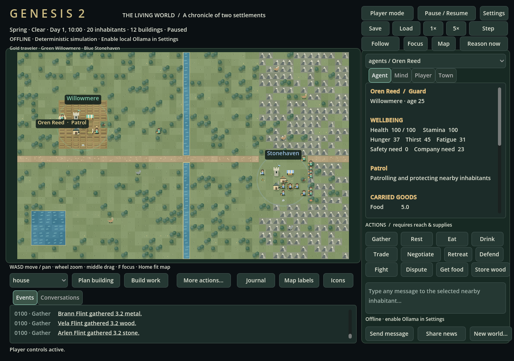
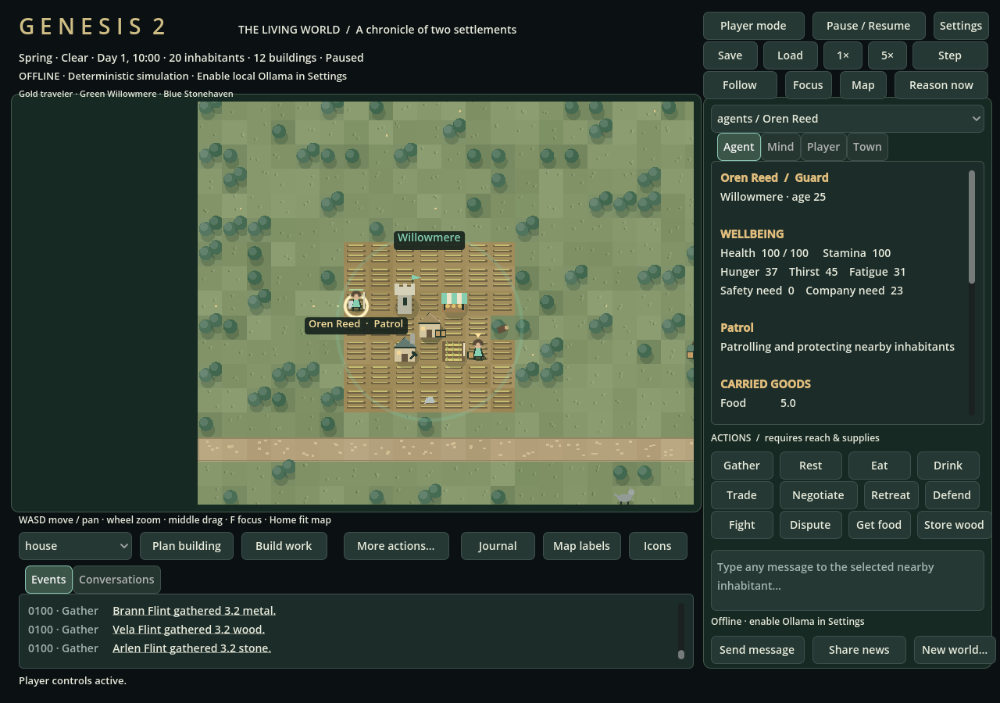

# Genesis client: visual and interaction update

The Godot client remains a presentation/input layer over the Python simulation. Camera interpolation, procedural artwork and feedback never change authoritative positions or outcomes. No external art, font downloads, shaders or new runtime dependencies are required.



## World presentation

- A retained terrain layer draws patterned grass, clustered trees, rock ridges, rippled water/shorelines, crop rows, roads and planked bridges. Seasons tint vegetation. It redraws when terrain, bridges or season change, rather than every animation frame.
- All ten building types have distinct silhouettes: house roofs/windows, planted farms, storage crates, workshop chimney/tools, striped markets, road paving, bridge rails, wells, banners on halls, and crenellated watchtowers. Scaffolds and a work-progress bar distinguish construction sites.
- Humans wear settlement colors; the traveler wears gold, guards carry shields/staffs, and incapacitated people lie down with a neutral aid marker. Selection/follow rings, health bars and activity markers show visible state. Deer have antlers; boars have a compact animal silhouette.
- Active conversations show speech markers. Material carriers/couriers have cargo markers. Construction/rest have activity cues. Disputes connect their participants. Completed construction, exchanges and conflict outcomes briefly appear on the map, once per event.
- Labels stay a readable size while zooming. Settlement names and selected entity activity remain inspectable. Labels/icons can be toggled. Follow interpolates smoothly; Focus/F centers the selected entity; Map/Home fits the whole world; wheel zooms at the cursor; middle drag pans.



## Interaction

The slate/green theme and warm headings apply to inspectors, inventory, journal, settings and action panels. Needs, goods, skills, goals, individual plan steps, knowledge sources/confidence, memories and relationships are formatted as readable sections. The Mind tab explicitly shows reports **remembered from the player**, including uncertainty. Old saves keep existing identities; newly generated worlds use distinct fictional personal names.

WASD/arrows move the Traveler in Player mode and pan the camera in Observer mode. Observer mode disables player actions. Click entities or use the selector; event links focus their actor. Map drawing stays clipped to its viewport.

**Send message** sends arbitrary text to a nearby selected inhabitant in LLM mode. Conversations show source-labeled turns, topic, status, failures and mechanically confirmed action outcomes. Queue/thinking/your-turn status accompanies the input. NPC speech is model-authored; offline activity is never presented as generated dialogue. **Journal** expands events and conversations, with an option to observe all discussions instead of the selected inhabitant only. Inference and HTTP polling remain asynchronous.

**More actions** exposes Trade, Workshop, Council and Build tabs: voluntary offers/accept/reject, crafting, teaching, stocks, repair, proposals/votes and tile placement. Engine rejection messages appear in the status line. Settings apply validated provider/model/endpoint/budget configuration; credentials are not stored in the UI. Hover the cognition header for measured throughput/latency/errors. Mode and provider errors remain visible without flooding the main header with counters.

The popup layout now has one content root, preventing its close button from covering all tabs. Numeric settings are formatted as integers where required, so an unchanged Settings form can be applied successfully.

## Validation performed

Godot 4.6.3 on Linux passed import, actual-scene smoke against the live Python backend, and the synthetic presentation checks:

```sh
python3 run.py --headless --offline --port 8768 --save /tmp/genesis-client.sqlite
# In another terminal:
bash scripts/check_client.sh http://127.0.0.1:8768
```

The smoke checks populated inspectors/inventory, camera fit/focus/zoom, modes, journal, settings types and popup geometry. `godot/tests/presentation_check.gd` exercises eight terrain and ten building types, construction, both animals, player/guards/incapacitation, conversation/cargo markers, event deduplication, cache invalidation, centered focus and markup escaping.

**Actual graphical execution also occurred:** Xvfb was extracted to a temporary directory, and Godot ran through X11/Mesa llvmpipe (software OpenGL), not the headless renderer. Captured pixels were inspected. XTest mouse/keyboard events exercised mode switching, movement, focus/zoom, Mind, Journal, action tabs and Settings. Observer movement preserved the player location; player movement changed its authoritative location. Editing the global budget to 65 and clicking Apply changed the backend configuration. The screenshots above come from the real client and simulation.

A graphical smoke can capture both overview and focused images with:

```sh
godot --path godot -- --smoke --api=http://127.0.0.1:8768 --capture=/tmp/genesis.png
```

This is automated graphical validation in a virtual Linux display. A human desktop playtest, Windows/macOS behavior, accessibility/high-DPI review and hardware-GPU profiling remain unverified. The layout uses a stretched 1280×900 canvas; the procedural art remains deliberately simple.
