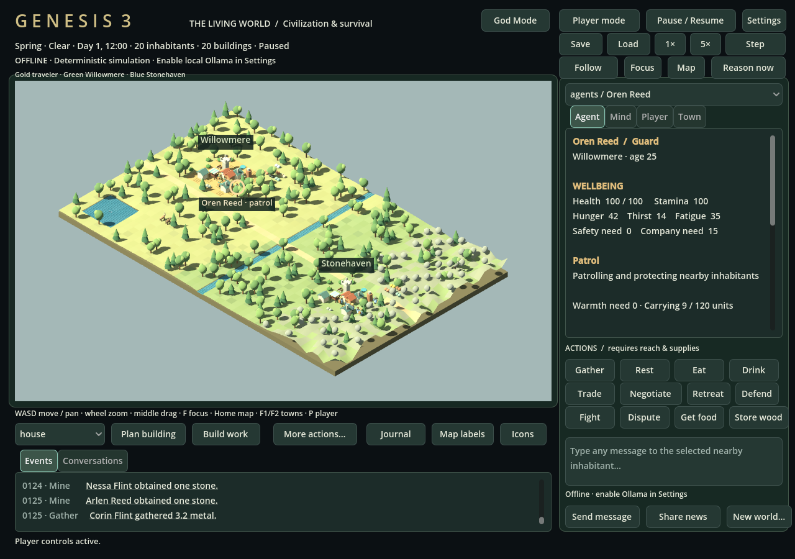
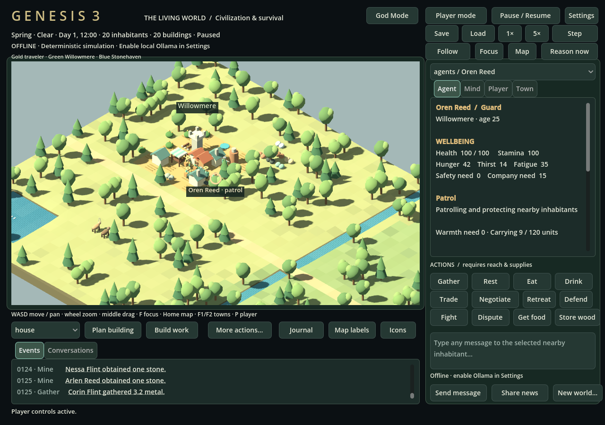
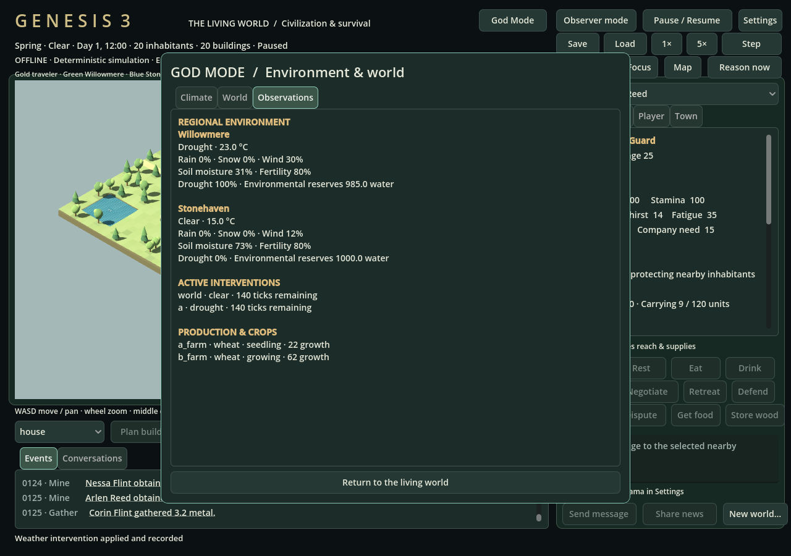

# GENESIS 3 — The Living World

This integration starts from `813447d`, preserving the validated v2 agent architecture, graphical follow-up, original tests and main branch. It adds a playable orthographic 3D client and connected production, ecology, climate and observer systems. It is a source release; the complete long-term civilization vision is not claimed finished.



## Install and play

Python 3.11+ and Godot 4 are required. Python uses only its standard library. Godot 4.6.3 was tested. No art downloads, pip packages or cloud model services are required for offline play.

```sh
git clone --branch feature/genesis-3-world https://github.com/NxFi3/genesis.git
cd genesis
python3 run.py --offline
```

For local cognition, install and start Ollama, install your chosen model, then run:

```sh
ollama pull qwen2.5:7b
python3 run.py --ollama --model qwen2.5:7b
```

Settings also support an OpenAI-compatible provider. The model endpoint is on the backend computer; localhost in a cloud machine does not point to your PC. **Real Ollama inference was unavailable in the implementation environment.** The independent asynchronous scheduler and genuine provider paths are preserved; fake-provider tests do not establish model quality.

Use a new save for the complete founding world: `python3 run.py --offline --save data/genesis3.sqlite`. Existing version-1 saves migrate with safe defaults and retain their inventories, agents and history. Newly introduced founding stock/facilities are generated only for a new world, never added on load. Saves now write version 2. Back up a save before opening it in an older version of the game.

- WASD/arrows move the real backend player; Observer mode pans the camera and disables player actions. Wheel zooms at the cursor; middle drag pans; F focuses selection; Home fits the world; F1/F2 focus and follow the towns; P follows the player. Follow also works for the selected settlement or inhabitant.
- Click figures, buildings, resources or animals, or use the selector. The inspector shows actual needs, warmth, carrying mass, work progress, goals, memories, relationships and inventory. Town includes local weather and crops. Journal retains source-labeled dialogue and mechanically confirmed social outcomes.
- Talk to a conscious inhabitant within three simulation tiles when a model is connected. Replies queue asynchronously. Agents retain private knowledge and may refuse or disagree. No generated conversations are fabricated for offline mode.
- More actions → **Survival** exposes timed mining/fishing, environmental water collection, non-graphic hunting, crop planting/harvesting/irrigation, fuel and extinguishing. Select the relevant object and approach it first. Player mining/fishing continues for one extraction after a click; moving cancels that work.
- More actions → **Industry** starts/checks timed recipes, cancels/refunds reserved inputs, repairs equipment, opens/closes gates and repels nearby optional threats. Stay near the compatible home facility for production to progress. Input/output details live in the resource registry.
- Existing trade/offers, teaching, council proposals, construction, repair, combat strategies, save/load and arbitrary player dialogue remain available. Explicit tile placement uses the isometric projection, not screen X/Y as simulation coordinates.

Use `python3 run.py --flat --offline` for the preserved top-down renderer. To run only the backend, use `python3 run.py --headless --offline`. Alternate ports and saves are supported. Windows uses `python` where appropriate; Windows/macOS were not executed here.



## Connected systems

`genesis/data/resources.json` defines 32 resource identifiers, categories, game units, mass, nutrition, decay and sources, plus 14 timed transformation recipes. It is checked on import. Gold/silver are commodities, not currency. The old `food`, `water` and `metal` identifiers remain compatible; `water` means collected drinking water in an inventory, while environmental source objects have separate locations, stock and replenishment.

Mineral veins are finite. Mining consumes stamina and work ticks; a nearby completed mine speeds it up. Ore/fuel become ingots at a furnace; planks/bricks, tools, equipment and cooked food require defined inputs and compatible facilities. Production escrows owned inputs, pauses when the worker leaves/is unsafe, and creates output once at completion. Cancel refunds escrow once. Net barter capacity is checked before committing either side of an exchange.

Plants, fish stocks and water reserves replenish according to their rules. Wildlife wanders with habitat preferences, flees, can defend itself, feeds from nearby modeled food and reproduces under caps. Hunting produces actual meat/hides; sheep additionally provide wool. Fishing consumes the location's stock. Food decays proportionally; communal barn/warehouse storage slows spoilage. Wheat/vegetables consume seed and water, grow with temperature/moisture/fertility, and provide a single harvest plus seed. Farmers can retrieve communal seed, replant and irrigate when fallback behavior permits. Defined edible foods satisfy hunger; cooking uses real ingredients and fuel.

Campfires/hearths consume owned fuel and burn for bounded time. Rain shortens exposed campfire duration. Heat, shelter and coats reduce cold need; excessive cold affects health. Rain collectors add collected rain to community water; wells transfer actual nearby environmental stock. Water can be carried/traded, or consumed directly at an accessible reserve. Full packs cannot bypass mass limits or trap an agent in recursive withdrawals.

Twenty-one building types have geometry and mechanical use. Houses/halls provide shelter; farms grow food; storage/barns/warehouses affect capacity/preservation; workshops/carpenters/furnaces/blacksmiths support production; mines speed extraction; roads/bridges alter travel; wells/collectors supply water; markets influence exchanges; towers support defense; fires heat/cook; walls and gates affect pathfinding. New structures require costs, work and valid positions. Remote mines/barriers/campfires consume carried supplies.

## God Mode

God Mode opens a dedicated observer panel. It supports all listed weather types, temperature and intensity overrides, duration, time, season, speed, pause, difficulty, replenishment, wildlife spawning and optional threats. Changes can target the whole world, either town's region, or an explicit rectangle. Rectangles use tile bounds rather than a drag-selection tool. Natural mode removes climate/clock overrides. Invalid requests fail before mutation.

Regional climate tracks temperature, rain/snow/wind, moisture, fertility and simplified flood pressure. Drought reduces replenishment and crop growth; cold affects warmth; precipitation/snow/flood pressure slow travel; storms cause bounded wear. World-control events enter persistent history. Speed/pause and climate controls restore with a save.



The screenshot shows a real mouse-applied Willowmere drought: its moisture dropped to 31%, while Stonehaven remained at 73%. Crops and water reserves differed in the same running world. Agents receive local observations; the model may choose supported responses such as irrigation, trade, production or construction. A fake-provider regression demonstrates the validated response path; no real-model adaptive behavior is claimed from it.

Optional zombies are disabled by default, capped at three and spawned away from inhabitants. Their range, movement, stamina, impacts and guard/player defense are engine-owned and non-graphic. Civilians may retreat. Disabling the option clears them; no automatic wars or infestation campaign is implemented.

## Engineering boundaries and remaining limitations

- The authoritative world remains a 2D grid. Elevation/slopes are presentation data, not 3D physics or terrain excavation. Tree meshes depict forest terrain; individual tree chopping/regrowth is represented by wood deposits rather than a complete tree population model.
- Climate/soil are regional abstractions. Flood pressure affects travel; there is no fluid simulation or flood-inundation mesh. Weather particles are lightweight overlays, not a regional volumetric weather system.
- The old instant `craft` API and legacy unplanted-farm food production remain for save/test compatibility. New `produce` recipes and planted crops use the new timed pipeline. Founding workshops and their limited stocks are explicit initial conditions, not claimed autonomous construction.
- Food spoilage is fractional decay, not tracked expiration batches. Water purification, disease, animal genetics/aging mortality, unrestricted invention and a full supply-chain optimizer are not implemented. Sheep/wolves have the same lightweight foundation, not detailed species ecology.
- Equipment affects mechanics and wears/repairs, but there is no slot system, looting, durability-based mesh replacement or complete animation library. Fantasy threat AI is deliberately small.
- Councils, social commitments and barter retain v2 limits. Humans do not reproduce/migrate or found new towns. New jobs/actions extend supported capabilities rather than promising unrestricted model-generated mechanics.
- Godot uses a stretched 1280×900 UI. A human usability/accessibility review, native Windows/macOS execution, target RTX 5070 profiling and a packaged executable remain unverified. The fallback renderer preserves v2 presentation and has less visual detail for new content.
- Working events, memories and completed jobs are bounded. SQLite's persistent event archive grows on disk. Reasoning quality and throughput require a real local model and its own measured acceptance run.

See [validation-v3.md](validation-v3.md) for executed checks and the exact evidence boundary.
